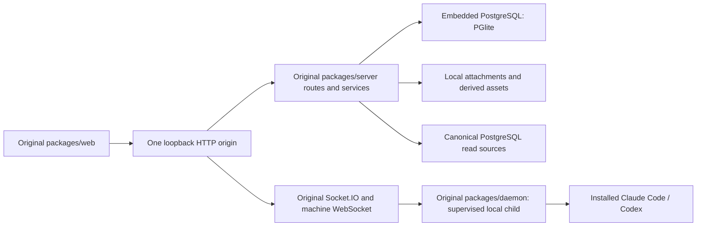

# Raft standalone

Status: infrastructure, password-based local sign-in and source-built local
Computer supervision are implemented. A real browser has connected the host,
detected native runtimes and verified reconnection after a server restart. Native
model/tool execution and full product parity remain unverified. The separate
`raft-local` worktree and its data are not imported or modified by this profile.

## Architecture

The standalone application should be a deployment profile of Raft, using the
original packages in this checkout. It should share product behavior rather than
copying selected components into another application.



The target is one launch command and one public port. The original daemon and
native agents may run as supervised child processes: preserving their process
isolation, cancellation, protocol and recovery logic is more useful than forcing
them into the HTTP process. No Docker, PostgreSQL service, Redis, RisingWave,
object-storage service or cloud provisioner should be mandatory.

PGlite already exists in the original server. It keeps PostgreSQL semantics,
Drizzle models, migrations and business services. Replacing these with SQLite
would require another persistence implementation and reduce reuse.

## Implemented foundation

- `src/standalone.ts` configures the profile before loading the normal server.
  It loads dotenv first so the later server import cannot restore removed cloud
  settings. Native model-provider configuration is not copied or overwritten.
- `RAFT_DEPLOYMENT_MODE=standalone` explicitly selects PostgreSQL Activity,
  followed-thread, sidebar and agent inbox reads. Standard mode continues to
  require RisingWave. Backend errors do not silently select another source.
- The original PostgreSQL reference implementations have moved from test helpers
  into production service modules. Tests retain compatibility exports. These
  shared implementations are not independent proof of RisingWave parity; the
  existing RisingWave contract tests and real parity checks retain that role.
- The normal server mounts the original web build after its API routes, on one
  loopback port. Missing APIs and assets remain JSON 404s instead of returning HTML.
- Original authentication, membership checks and rate limits remain enabled.
  Persistent PGlite is no longer mistaken for the disposable integration harness.
- Standalone sign-up and password sign-in do not require mailbox verification.
  Email is a local account identifier. The shared `emailVerified` gate represents
  local account acceptance in this isolated profile, not proof of mailbox ownership.
  New accounts create no verification token and send no verification email.
  Existing unverified accounts recover only after password verification and locked
  credential revalidation. Pending verification tokens are removed in the same
  transaction. Standard deployments retain the original email verification flow.
- The auth-provider response identifies standalone mode. The original sign-in
  and registration forms show local guidance, hide unsupported email reset and
  social sign-in, and recover old verification screens through password sign-in.
  No anonymous login, fixed password or test auto-verification flag is used.
- PGlite state, uploads and a private persistent JWT signing key share an isolated
  state directory. First-start key publication is atomic and does not change the
  key on restart.
- Local attachments reuse the original filesystem backend. `content/v2` derived
  assets also use local files. Browser-direct S3 uploads are not advertised as a
  local capability; API-mediated upload remains the local path.
- Hosted provisioning, hosted migration import, hosted recap/spend reporting,
  analytics funnel worker, raftbench and the separate metrics listener are not
  started by this profile. Core orchestration, message/read-state workers,
  reminder watchdog and Socket.IO remain the original implementations.
- Single-process machine leases, activity snapshots and wake locks use a local
  `ReplicaStateStore` adapter. This avoids requiring Redis for Computer
  registration. These coordination snapshots, including crash-loop breaker
  episodes, reset on restart; durable application data remains in PGlite. Run
  only one server process per state directory. Standard deployments retain the
  original Redis adapter and its failure behavior.
- The launcher removes inherited remote database, Redis, RisingWave, S3,
  ScopeDB, Slack Bridge and mail-provider settings. It disables Stripe billing,
  remote trace export and ECS drain discovery for this isolated profile.

## Local Computer connection

Create an account and workspace through the original setup flow, then choose
**Use server host**. The authenticated action requires the original
`registerMachines` capability. It attaches a Computer through the existing
credential service and starts the locally built daemon as a supervised child.
There is no CDN installer, global CLI installation, operating-system service or
manual pairing token in this path. Native Claude Code and Codex must already be
installed and configured. Agent creation remains the original UI workflow.

The server builds `packages/daemon/src/standaloneRunner.ts` into
`packages/daemon/dist/standaloneRunner.js`. This entrypoint imports the original
daemon rather than replacing its protocol, native drivers or tool handling.
The managed daemon uses one loopback WebSocket connection to the server; it does
not expose another public port.

Private attachments live under `<state>/computers/<server-id>/` (directory mode
0700), with `computer.key` and `attachment.json` mode 0600. Keys are passed by file
path, never returned to the browser or included directly in command arguments.
Repeated connection requests reuse the same Computer. Server restarts reuse its
credential; revoked credentials or lost owner permissions do not silently issue
a replacement. Restoring or repairing a revoked attachment currently requires
operator intervention.

The child retains `HOME`, `PATH`, `CLAUDE_CONFIG_DIR`, `CODEX_HOME` and native
provider configuration. Raft workspaces/logs use its isolated `RAFT_HOME` and
`SLOCK_HOME`; server database/JWT/Redis/storage secrets are removed from the child
environment. Shutdown stops the owned runner, with bounded crash-restart backoff;
parent IPC disconnect also requests daemon shutdown. Online status comes from
the original authenticated machine connection, not successful process creation.

External Raft Computer connections remain supported through the standard setup
flow and credential APIs. The generated external command preserves a custom
self-hosted server URL even when no deployment label is configured. Automatic
upgrades of the source-built local runner are not managed by a global CLI; rebuild
and restart this checkout to update it.

## Remote execution machines

Standalone supports one center and multiple execution machines. In **Connect a
Computer**, choose **Server host** or **Another machine**. The remote flow serves
a private runner archive from the authenticated center; only workspace owners
and admins with `registerMachines` can download it. The archive contains the
built original daemon and the installed production dependency graph, including
dependency licenses. It contains no center database, JWT key, native credentials
or user state. No registry install or vendor installer runs on the target.

`pnpm standalone:build` builds the runner package as well as the original web
application. After rebuilding the daemon separately, use
`pnpm standalone:remote:build` to refresh the package. The package is specific to
the build host's OS/architecture and requires Node 24+ on the target. Set
`RAFT_NODE_BIN` when Node is not available as `node`. The page displays the
archive SHA-256; verify it after transfer before extracting and executing it.

For the current loopback-only center, run this on the execution machine, replacing
the SSH destination, and keep the tunnel open:

```sh
ssh -N -o ExitOnForwardFailure=yes \
  -L 127.0.0.1:15280:127.0.0.1:5280 admin@ADMIN_HOST
```

In another terminal on that machine, after extracting the archive:

```sh
cd raft-runner
./connect setup --server-url http://127.0.0.1:15280 \
  --server allinone-dev1 --name dev-b
```

Open `/login/device` on the center in your existing browser and approve the
code printed by this runner. The runner reuses the existing device authorization,
Computer attachment and authenticated daemon WebSocket protocols. It creates a
unique Computer identity and stores its key locally with mode 0600. The human
session is used only for attachment and is not saved by this runner. A subsequent
setup resumes the saved attachment; `start` with the same flags starts it without
requesting another approval. `status` prints local identity without credentials.
The runner stays in the foreground; keep the terminal open or supervise this
command with your own user service. No OS service is installed automatically.

Each center/workspace gets an isolated default state directory under
`~/.raft-standalone/remote/`. `RAFT_HOME` can override it, but must be a private
directory. Hostname, OS username and native home are checked on restart to catch
accidentally copied attachments. This check is not hardware attestation. Never
clone machine credentials or native session directories. An interrupted enrollment
or a changed host identity requires operator recovery rather than silent issuance
of replacement credentials.

Create an agent in the center and explicitly select its Computer. The picker
shows the reported hostname; the agent profile also shows its execution host and
machine ID. Standalone rejects native agent creation without a selected machine.
An offline Computer is not replaced by the center host. Changing the machine
assignment and migrating its files/sessions remain separate existing operations.

The original daemon creates each agent's managed workspace on its execution
machine. Local Claude/Codex configuration and provider login are read there, under
the runner's OS user. Native project paths refer to that host. Separate OS users
or an actual sandbox are required for file access isolation; a working directory,
display name or `RAFT_HOME` is not a filesystem permission boundary.

Remote runners apply the same nonessential-traffic and telemetry flags as the
bundled local runner before loading the original daemon. They accept HTTPS center
origins, or HTTP loopback for tunnels, reject redirects during device enrollment,
and never silently use the public Raft API. Native models and tools retain their
existing network authority, as described below. Multi-center replicas, shared
PGlite directories and transparent native-session failover are not enabled.

## Privacy defaults

Standalone now applies an application privacy policy in addition to local
storage. `GET /api/privacy-policy` reports the effective deployment profile,
preview behavior, disabled service categories, and the native isolation gap.

- Web pages use system fonts. They do not import Google Fonts or probe Gravatar
  in standalone. Community QR configuration stays on the local origin. Uploaded
  avatars remain available. The standalone HTML marker is injected before app
  scripts on both SPA routes and `/index.html`, avoiding a configuration-load race.
- The standalone page CSP allows application requests only to its own origin.
  Inline styles, local workers, data images and blob previews remain available.
- HTML attachment previews are static and offline by default. A browser-compatible
  HTML parser removes scripts, event handlers, refresh directives, forms, frames,
  external links and active SVG. A response CSP independently refuses scripts and
  outbound resources. This also applies to a preview opened directly. The original
  object and download are unchanged. Inline previews are capped at 2 MiB; larger
  files can still be downloaded. Interactive charts and the scripted attachment
  selection/measurement bridge are unavailable in this mode.
- Automatic Computer release checks, vendor feedback, translation, push delivery,
  app webhook delivery and server-managed remote MCP are disabled at their service
  boundaries. Inherited credentials do not enable them. Configuration for feedback,
  translation, trace relay and external push is also removed at launch. Selected
  API routes return `standalone_external_service_disabled` rather than forwarding.
- The managed local runner requests that Claude disable nonessential traffic,
  telemetry, error reporting and automatic updates. Standalone Codex launches
  explicitly set `analytics.enabled=false`, `feedback.enabled=false` and
  `otel.exporter="none"`. Native provider settings and credentials remain in their
  original locations; no native settings file is rewritten.

These controls do **not** restrict a native program's network sockets or file
access. Claude/Codex model calls still leave this machine through the configured
provider. Native MCP servers, installed skills, hooks and shell tools can still
communicate externally. Native permission bypass is unchanged; the application
policy is not an operating-system sandbox or a model-gateway allowlist.

The next isolation stage requires a dedicated runtime identity, explicit readable
and writable directories, and an OS-enforced network boundary that allows only
approved model/MCP destinations (including redirects, DNS and IPv6). This host
currently has no Bubblewrap/Firejail launcher configured. Do not replace this
boundary with a prompt rule, working directory, proxy variable or JavaScript
`fetch` wrapper. The API deliberately reports native network isolation as
`not-enforced` until such a boundary exists. Other optional integration adapters
and user-initiated external navigation are outside the enforced categories above.

## Feature reuse and acceptance

| Area | Intended reuse | Current evidence / remaining work |
| --- | --- | --- |
| UI and navigation | Original React pages, stores, Raft UI library, contracts | Original production web assets built; real browser opened Sign In without page errors |
| API and authorization | Original Express routes, sessions, membership and capability checks | Real server started with a fresh persistent PGlite database; `/health` succeeds; local registration, recovery of unverified accounts and session refresh covered by API integration tests |
| Threads, tasks and memory | Original services, schemas, routes and UI | Code retained; complete browser workflows pending |
| Activity and unread state | Canonical PostgreSQL queries replacing RisingWave reads | Real PGlite integration test covers sidebar/read cursor and agent inbox recovery/list |
| Claude and Codex | Original daemon, native drivers and normalizers | Real local connection and native version detection passed; actual model run pending |
| Native configuration and skills | Original driver discovery, HOME and provider isolation behavior | Configuration locations preserved; actual skill loading and provider requests remain to be checked per runtime |
| Streaming and tool results | Original machine protocol, daemon event normalization, web rendering | Retained in source; end-to-end native tool execution pending |
| Permissions and approvals | Original runtime policy and application capabilities | Retained; review defaults before native smoke tests; original Claude launch currently requests bypass permissions |
| Recovery, reminders and collaboration | Original outbox, inbox, lifecycle, task and reminder services | Core workers retained; restart, resume and scheduled execution acceptance pending |
| Attachments | Original authenticated API and filesystem backend | Local public-content storage test added; full upload/preview browser flow pending |
| Billing, hosted machines, email, external integrations | Optional adapters / unavailable capability UI | Hosted workers disabled; the UI still needs a standalone capability projection |
| Existing mini-app data | Explicit, versioned importer | No automatic migration; current data and running preview preserved |

No capability percentage is assigned: retained source, build success, offline
tests and an end-to-end native run are different kinds of evidence.

## Run the foundation

Use Node 24 and the pinned pnpm 12.11.2 on a compatible Linux userspace:

```sh
pnpm --filter @botiverse/raft-server... --filter @botiverse/raft-web... --filter @botiverse/raft-daemon... --filter @botiverse/raft-trace-upload-worker... install --frozen-lockfile
pnpm standalone:build
pnpm standalone
```

The trace-upload-worker filter installs dependencies referenced by the server's
existing tests; it does not start another service.

Defaults:

| Setting | Default |
| --- | --- |
| `RAFT_STANDALONE_PORT` | `5280` |
| `RAFT_STANDALONE_DIR` | `~/.raft-standalone` |
| `RAFT_STANDALONE_WEB_DIST` | `packages/web/dist` |
| HTTP origin | `http://127.0.0.1:5280` |

The profile binds to loopback. It does not turn local file access into anonymous
remote access. Use email and password to create a local account or sign in; no email
verification is needed. Accounts created before this change can use the same
password to continue from the old verification screen. Connect the host using
**Use server host** during Computer setup. Do not run two PGlite owners on
the same state directory. Back up the whole state directory while stopped.

## Validation on the current machine

The host has glibc 2.17. The pinned pnpm GNU executable cannot load, but the same
version's musl executable works. The lockfile was installed unchanged with
`--frozen-lockfile --ignore-scripts`. No package skills were approved or activated.

The locked `argon2` and `sharp` binaries also require newer glibc symbols. For
validation only, Debian glibc 2.36 was extracted under `/tmp/raft-glibc236`, and a
Node wrapper under `/tmp/raft-node24/bin/node` starts Node with that loader and
preserves child-process launches. System glibc and the shared Node installation
were not replaced. These temporary files are not a reproducible distribution;
packaging a supported runtime is an explicit release requirement.

Observed checks:

- Pinned dependency installation: passed; lockfile unchanged.
- Server TypeScript check: passed after installing the existing cross-package
  test dependency filter.
- Full `standalone:build`: passed, including web TypeScript, Vite, production
  devtools exclusion, feedback-workspace split, immutable-assets verification,
  Activity chunk-split check and feedback bundle. Existing dynamic-import
  chunking warnings remain.
- Standalone configuration, static routing and PostgreSQL read tests, plus existing
  sidebar unread, agent unread-summary and storage tests: 29 passed in 7 files,
  including local derived-content coverage.
- Live original server: `/health` returned `{"status":"ok"}` on port 5280.
  The first process shut down cleanly and the updated source was restarted
  against the same persistent state directory.
- Local authentication: 3 API integration cases and 11 web behavior tests passed.
  These cover signup without mail, legacy unverified account recovery, wrong
  password rejection, standard-mode verification, protected requests and refresh.
  Server typecheck, focused frontend lint and the full web build also passed.
- Browser: real standalone signup and password sign-in, including a stale verify
  URL, reached account profile setup. Reload retained the session; no page errors
  were reported. Browser accounts were created only in an isolated temporary
  state directory, not in the user's live database.
- Local Computer: 6 server tests cover authorization, private credentials,
  concurrent attach, same-credential resume, revocation, environment filtering,
  connection lease fencing, wake-lock expiry and local snapshot isolation.
  Frontend tests cover observed readiness, denied connections, polling recovery
  and custom self-hosted external CLI URLs. Server typecheck and production web
  build passed.
- Isolated real browser: profile/workspace creation and **Use server host**
  connected the original daemon without an external installer; no page errors
  were observed. Runtime detection completed, reporting Claude Code 2.1.187 and
  Codex CLI 0.163.0. Restarting the isolated server stopped its old runner and
  resumed the same Computer/key; the existing login session remained valid.
- No real model request, native tool-use evaluation, full test suite or data
  migration was performed. Runtime detection does not prove native model access
  or skill execution.

Local validation uses `.raft-standalone` in this checkout, which is ignored by
Git. Screenshots are stored under `.raft-standalone/validation`. The original
mini-app preview is a separate service and has not been replaced.

## Remaining migration sequence

1. **Local onboarding and ownership.** Password sign-in is available; add a
   first-run owner and workspace workflow using the normal user/session services.
   Preserve HTTP and Socket.IO authentication; do not ship the test harness, fixed
   passwords or an anonymous auth bypass.
2. **Managed local Computer.** Source-built supervised startup, private credentials,
   readiness, crash backoff and restart resume are implemented. Add an explicit
   repair flow for revoked attachments and surface handshake timeouts. Preserve
   HOME and native settings without duplicating Claude/Codex credentials.
3. **Runtime compatibility.** Check native CLI detection, model configuration,
   installed skills, provider isolation, permission defaults and tool-result
   fidelity. Keep runtime-specific behavior in original drivers. Do not equate
   native bypass permissions with platform approval semantics.
4. **Capability-aware UI.** Reuse original components; hide unavailable hosted
   provisioning, billing and OAuth entrypoints through a server-owned capability
   response. Keep threads, tasks, memory and agent activity in their original UI.
5. **Acceptance gates.** Exercise login -> channel -> thread mention -> native
   driver -> tool output -> reply, then cancel/approval, restart/recovery,
   reminder, tasks/worktrees, attachments and memory. Test deterministic protocol
   fixtures first; run paid model cases only within an explicit test scope.
6. **Package and migrate.** Pin a host-compatible runtime, add one foreground
   launcher and optional user service, export/import backups, then implement the
   mini-app importer with identity mapping, message/thread ordering and rollback.

The current foundation supports this direction without a second UI, database
schema, task engine or agent harness. Functional parity is an acceptance backlog,
not a consequence of importing the original packages.

## Licensing

Keep the repository's FSL-1.1-ALv2 terms and existing notices. Published library
packages can have different licenses (for example Raft UI's MIT package). A
standalone deployment profile does not relicense the original application.
