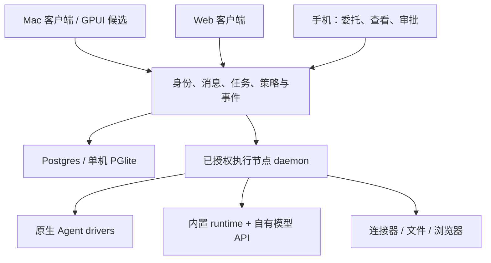

# Personal Agent 产品设计 v0.1（历史方案）

本方案已由 [产品设计 v0.2](product-design-v02.md) 取代。v0.2 以持续工作的 Bot 为主对象，补齐任务、工具、接管、成果、技能与定时工作的完整闭环。下文保留作早期实现背景。

## 1. 产品判断

面向有持续研究、写作和技术工作需求的个人，提供一个能接续工作的助理入口。用户可以沿用已经登录的本地 Agent，也可以显式配置模型 API。平台负责会话、任务、设备、交付物和需要用户处理的事情，不以“支持多少模型”作为主界面。

一期先在 Mac 上成立。平台按“客户端—控制服务—执行节点”划分，后续 Web 和手机共享任务状态与授权语义。第一轮在现有 Web 客户端迭代可运行的产品切片；它与完整 Mac 应用的一期目标分开验收。

主要用户：已经使用 Claude Code / Codex / Pi 等工具，希望不用每次从终端重建上下文的个人。第二类用户通过自有 API 启动内置 runtime。普通用户的零配置托管体验是后续目标。

## 2. 三条需要走通的工作

| 场景 | 输入 | 合格交付 | 不合格行为 |
| --- | --- | --- | --- |
| 研究与写作 | 一个主题、来源范围、输出要求 | 有来源和边界的文档，保留修订 | 把生成摘要写成已验证事实 |
| 本地工作 | 明确目录及任务 | 变更摘要、文件入口、检查结果 | 宣称工作目录等于安全隔离 |
| 长期跟进 | 目标、时区、频率、通知条件 | 可暂停的 routine，仅在有意义变化时通知 | 同一内容重复推送，离线时谎称执行 |

默认一个助理承接工作。增加专长 Agent 时说明它继承什么、在哪台电脑执行、能调用哪些服务。用户不负责在 Agent 间手工搬运背景。

## 3. 信息架构与主窗口

```text
个人助理      对话列表 / 当前任务              成果或执行详情（按需打开）
  对话       输入目标；选择助理；实际执行位置
  待处理     登录、授权、结果复核、失败恢复
  成果       文档、文件、版本、来源
  自动化     已启用 / 暂停 / 最近一次执行
  设置       设备、Agent、API、连接器、记忆
```

主窗口建议初始 1180×800，最小 900×640；列表可收起，详情可调整宽度。主任务是描述目标和继续工作，配置入口为次级动作。移动端保持同一任务对象，列表与详情分屏切换。首轮页面 `/s/:serverSlug/personal` 复用现有登录、工作空间与实时数据，只增加个人入口，不改变所有现有路由的默认行为。

### 首页

一个目标输入框，紧邻助理选择和执行位置。已有 Agent 时可直接开始；没有 Agent 时显示创建入口和简短解释，不出现假的工作统计。提供研究、本地整理、代码检查三个可编辑起始提示，点击只填入文本，不直接执行。

发送成功后进入真实 DM。任务在 DM 中成为现有的 message task，后续回复、线程和成果沿用原有能力。发送失败保留文本；网络响应丢失时用相同 randomId 重试，减少重复创建。首页的成功含义仅是服务端接收，不代表任务已经开始或完成。

### 首次使用

完整一期：启动本地服务 → 创建本地身份 → 连接这台 Mac → 检测 runtime → 创建一个助理 → 第一个成果。检测结果分开表达“发现程序”“已认证”“模型请求成功”；不得用前者替代后两项。

本地 Agent 默认继承执行电脑的原生配置。API 模式单独填写供应商、协议、地址、凭证和模型；连通性测试必须选择执行节点，因为中心可访问不代表执行节点可访问。本轮复用已有创建 Agent 和 AI Providers 表单，不另造同义配置。

### 对话与任务

对话是长期关系；任务是一次有完成条件的委托。默认显示阶段概述、最近进展、执行设备和交付物。原始工具事件放在可展开的详情中。正在处理一个长任务时，用户可以补充约束；新独立任务可开新线程。停止按钮中断当前执行，归档助理是另一项操作。

### 待处理与审批（一期后续迭代）

显示对象、动作、范围、目标账户、预期变化、有效期和任务来源。允许一次、拒绝、打开接管、查看详情。批准绑定 action digest 和版本，修改对象或内容后重新审批；同一审批只能消费一次。超时、权限撤销、设备迁移后旧审批失效。

不能依赖前端按钮或 system prompt 实施权限。连接器经凭证代理和策略执行；本地通用 shell/浏览器若仍能旁路，应明确标为用户完全信任的执行模式。只在具备 OS/VM 隔离和出口控制后，才能把 UI 策略称作强制约束。

### 记忆与成果（一期后续迭代）

记忆项有来源、更新时间、适用范围和用户修订入口。区分用户明确偏好、任务事实和待验证推断。删除不等于所有历史副本即时消失；需定义备份保留与重建策略。成果记录实际路径/下载、版本、生成任务、来源和验证结果，不用一段聊天文字冒充文件已生成。

## 4. 状态与恢复契约

| 产品状态 | 依据 | 用户动作 |
| --- | --- | --- |
| 正在提交 | 本地请求在途 | 保留文本，禁止重复点击 |
| 已接收 | 服务端消息回执 | 打开对应对话 |
| 等待执行设备 | 调度确认设备离线 | 唤醒原设备或明确迁移 |
| 执行中 | runtime 报告真实进度 | 补充、停止、查看过程 |
| 等待处理 | 有结构化 action request | 查看具体对象并审批/接管 |
| 待验收 | 有成果且声明检查范围 | 打开成果，接受或要求修改 |
| 失败 / 结果未知 | 错误或回执缺失 | 查看原因，同一请求重试或核验 |

这些是目标状态，第一轮只实现输入、真实执行位置、发送与失败恢复入口，尚未增加统一任务状态机。既有 `in_review` 也不能被重新标为“权限审批”。

本地执行时：退出浏览器不等于停止后台服务；服务退出或 Mac 睡眠时工作可能暂停。未来需要常在线节点才能提供合盖后继续承诺。切换设备必须显式确认会话、文件和凭证来源，不得静默改到中心执行。

## 5. 多端与运行时设计



复用 serverId 作为个人空间的隔离标识，首轮不迁移数据库。未来在兼容层上提供 TaskRun、ActionRequest、Artifact、MemoryItem、ConnectionRef，所有客户端用同一契约读取，不分别推断状态。事件使用稳定 ID、任务版本和 cursor；掉线后从服务端补读，写操作带幂等键及预期版本。

AgentAdapter 的责任是探测、启动/恢复、发送/steer、取消、归一化事件和能力声明；LLM Provider 的责任是协议、端点、模型及凭证。两者分开：本地 Agent 可以使用远端模型 API，本地模型 API 也不等于本地文件隔离。优先扩展已有 RuntimeDriver，不先替换为新的通用框架。

## 6. 范围与里程碑

| 阶段 | 交付 | 验收 |
| --- | --- | --- |
| 本轮 M0 | 研究、源码说明、设计、个人入口、standalone API 凭证初始化 | 构建、行为测试、页面检查、真实 API 路径验证 |
| M1 Mac 日用版 | 本地身份/启动体验、一个默认助理、任务成果、重连恢复 | 研究/文件/代码三类任务各多次走通；睡眠与重启不丢状态 |
| M2 可靠自动化 | routine、审批、记忆管理、连接器 | 幂等、撤销、时区、调度漏跑、接管与重启恢复 |
| M3 多端 | 远程中心与节点、Web/手机、通知 | 同一任务跨端接续；离线可见；移动审批版本一致 |

完整一期不承诺支付、任意网站可靠自动化、示范学习、共享多人工作空间、云主机托管或模型无关的完全一致能力。Grok Bot 的这些能力是路线参照，需要逐项补齐。

衡量：首次有效成果耗时、任务有用成果比例、用户纠错/接管次数、重启恢复成功率、重复副作用数、无意义通知比例。建议试用门槛为首次成果十分钟内、可恢复任务的重启恢复全部通过、重复副作用为零；这些是设计目标，尚无测量值。
