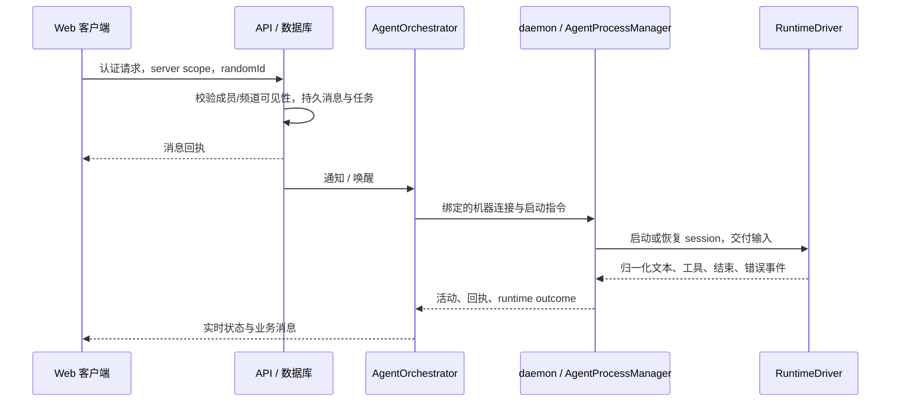

# Raft 源码解读：standalone 与标准部署

分析固定于 `1147a42b17831878cf9c1c6a65c31d1666fc033f`，本轮修改另外记录。这里的“正式版”指此快照中的 standard 部署路径；仓库是 release mirror，不包含厂商全部私有代码、线上配置或运行证据。

## 1. 同一产品，两种部署形态

| 层 | standard | standalone |
| --- | --- | --- |
| 客户端 | React 19、Zustand、React Router | 同一 Web 构建，由 API 同源提供 |
| API / 实时通信 | Express、Socket.IO、机器 WebSocket | 同一 app、鉴权与编排器 |
| 业务事实 | PostgreSQL / Drizzle | PGlite 持久目录，兼容迁移与查询 |
| 读取投影 | 指定业务读取依赖 RisingWave | 明确选择 PostgreSQL 读源 |
| 副本协调 | Redis 状态与跨副本路由 | 单进程 LocalReplicaStateStore |
| 文件 | 可配置对象存储 | 本地上传与衍生资源目录 |
| 执行节点 | 外部 Computer、云端供给等路径 | 源码构建 daemon 子进程，也可连接远端机器 |
| 外部服务 | 按部署启用推送、计费、托管等 | 启动器删除相关配置，服务边界禁用部分出口 |

入口：[standalone.ts](../../packages/server/src/standalone.ts) 先验证 Web 构建，再调用 [configureStandalone](../../packages/server/src/standalone/config.ts)，最后动态加载 [server.ts](../../packages/server/src/server.ts)。顺序是正确性约束：大量模块在 import 时读取环境，不能加载后再试图切换数据库或出口。

[db/index.ts](../../packages/server/src/db/index.ts) 识别 `pglite://`；[localReplicaStateStore.ts](../../packages/server/src/standalone/localReplicaStateStore.ts) 替代单机协调依赖。业务数据持久并不意味着进程协调快照也持久；重启后需要重连/重建。standalone 不能以多个进程共享一个状态目录模拟高可用。

## 2. 一条委托如何变成执行

客户端 [api/client.ts](../../packages/web/src/api/client.ts) 附带身份和 `X-Server-Id`。DM 由 [channelStore.openDM](../../packages/web/src/store/channelStore.ts) 通过 `/channels/dm` 创建/复用并订阅。发送由 [messageStore.sendMessage](../../packages/web/src/store/messageStore.ts) 调用 `/v2/messages`，传递 `randomId`、时区和可选 `asTask`。

[messages.ts](../../packages/server/src/routes/messages.ts)、[messageService.ts](../../packages/server/src/services/messageService.ts) 和 [taskService.ts](../../packages/server/src/services/taskService.ts) 负责验证、持久化、任务事实及通知。HTTP 已接收与 runtime 已消费是不同事实。现有 server task 列表刻意排除 DM/thread，因此个人首页不能直接复用它并声称显示了所有个人任务；本轮只展示真实 DM 入口，后续需增加个人任务读模型。

[AgentOrchestrator](../../packages/server/src/services/agentOrchestrator.ts) 管理机器注册、可达性、唤醒锁、启动派发、收件与恢复。关键入口是 `registerMachine`、`handleMachineMessage`、`startAgent`、`receiveMessages`；其中纯 plan 函数把“收到事件”和“应做动作”拆开，方便覆盖竞态与故障。它不是一个简单的 `spawn()` 包装。

[AgentProcessManager](../../packages/daemon/src/agentProcessManager.ts) 的 `startAgent`、`spawnAgentProcess`、`stopAgent` 管理进程、session、工作目录、输入债务和事件归属。仓库有 [runtimeOutcomeOutbox](../../packages/daemon/src/runtimeOutcomeOutbox.ts) 等机制，避免只靠 WebSocket 一次发送声明执行结束。适配个人产品应保留这些可靠性基础。

## 3. 本地 Agent 与模型 API 的边界

[drivers/index.ts](../../packages/daemon/src/drivers/index.ts) 注册 Claude、Codex、Grok、Pi、OpenCode、Built-in 等 driver；部分旧 runtime 仅为恢复历史 Agent 保留，不表示都允许新建。[drivers/types.ts](../../packages/daemon/src/drivers/types.ts) 描述 persistent/per_turn 生命周期、busy 输入策略、session recovery 和 `ParsedEvent`，不能让一个统一聊天流抹掉这些差异。

Codex driver 使用 app-server / JSON-RPC，Claude 有专用启动与事件解析，Pi / Built-in 使用 SDK。`grok` driver 是本地执行 runtime 的适配，不能由此推导已集成 Grok Bot 云端产品或它的客户端协议。

[providerConnectionService.ts](../../packages/server/src/services/providerConnectionService.ts) 管理 API 连接、模型、凭证与测试。凭证用 AES-256-GCM，AAD 绑定 server 与 connection；加密主密钥为 `SLOCK_PROVIDER_CREDENTIAL_KEY`。连接器表单和探测可复用，新增产品无需再做一个只把 API key 写进 localStorage 的配置页。真实执行仍在选定 Computer 上，不能用中心的探测替代节点探测。

原生配置继承细节已有 [Claude 说明](../standalone-claude-settings.md)。模型选项、原生账号认证和实际推理成功是三个不同层次。创建表单、连接与执行能力都需要分别验证。

## 4. 身份、凭证与权限

[agentCredentialProxy.ts](../../packages/daemon/src/agentCredentialProxy.ts) 使用 launch 对应的本地 token，限制代理目标 origin，并代理平台能力；真实平台凭证不直接成为 Agent 配置。这一机制适合继续承载连接器授权，但它不是本机文件系统或所有网络流量的沙箱。

特别需要保留的边界：基线 [codex.ts](../../packages/daemon/src/drivers/codex.ts) 的线程配置包含 `approvalPolicy: never` 与 `danger-full-access`；[claudeLaunch.ts](../../packages/daemon/src/drivers/claudeLaunch.ts) 包含 bypass permissions 参数。本地 Agent 在该模式下拥有宿主用户的较广权限。个人产品若要提供“发送前批准”的强保证，需要把副作用约束放到执行边界，并消除 shell/浏览器旁路；添加一个确认弹窗不能做到这一点。

## 5. standalone 的本机与远端连接

[LocalComputerManager](../../packages/server/src/standalone/localComputer.ts) 复用 Computer credential service，私有文件保存机器身份，通过 `fork` 监督构建后的 [standaloneRunner](../../packages/daemon/src/standaloneRunner.ts)。在线状态读取编排器的认证连接，而非“子进程创建成功”。本地 runner 保留原生 HOME/PATH，服务端密钥应从子进程环境移除。

[standaloneRemote.ts](../../packages/daemon/src/standaloneRemote.ts) 与远端 runner archive 路径复用设备授权和机器协议。远端电脑有独立身份与原生登录态；离线设备不会自动替换为中心。SSH tunnel 是连接 loopback 中心的部署选择，不等于多副本同步。

## 6. 客户端能保留什么，应该改变什么

[MainLayout](../../packages/web/src/components/layout/MainLayout.tsx) 持有实时 bridge、页面与对话生命周期；[socketBridge](../../packages/web/src/store/socketBridge.ts) 将实时输入交给 domain stores。个人首页放在这套生命周期内，避免新建一个显示成功但不接收后续消息的旁路应用。

可直接保留：登录、成员/频道鉴权、DM、线程、文件预览、Agent 创建/配置、Computer 管理、API provider 表单、driver 与恢复协议。

产品层应改变：默认入口、首次成果路径、待处理事项、个人任务查询、记忆修订、通知策略和成果验收。新增服务应围绕这些对象，小步扩展现有契约；不在本轮替换数据库、重写编排器或同时迁移所有 UI。
