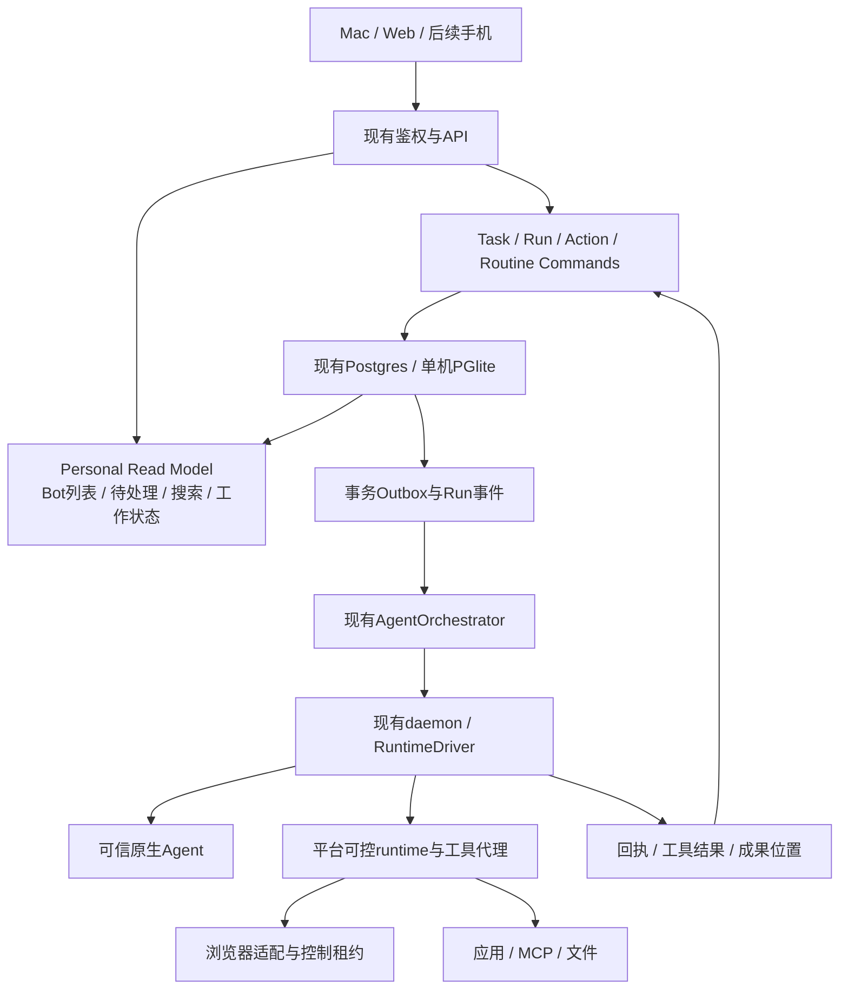

# v0.2 技术设计：在现有Raft上补齐产品闭环

2026-10-27；源码HEAD `1147a42b17831878cf9c1c6a65c31d1666fc033f`，工作区已有未提交的个人入口和主题变更。下列新增对象、API和模块是提案，尚未实现。本次不修改生产编排协议。

## 1. 复用边界

| 现有实现 | 可以复用 | 需要补齐，不能直接等同 |
| --- | --- | --- |
| `web/src/components/layout/MainLayout.tsx`、stores/socketBridge | 会话生命周期、实时更新、身份与路由 | Bot优先导航、待处理读模型、检查区 |
| `channelStore.openDM`、`messageStore.sendMessage`、server `messageService` | DM、消息、randomId、任务入口 | 工作中steer/queue回执、消息与Run关联 |
| `server/src/services/taskService.ts:805` | 任务、权限、状态转移与历史 | listServerTasks只查channel/joint，排除DM/thread；新增个人查询而非前端假合并 |
| `server/src/services/agentOrchestrator.ts`、daemon `agentProcessManager.ts` | 调度、节点连接、启动/恢复、事件归属 | 产品TaskRun投影、检查点、工作环境租约 |
| `daemon/src/drivers/types.ts`、`drivers/index.ts` | 生命周期、session恢复、busy投递语义、能力适配 | 产品能力声明与真实探测；注册driver不代表每项功能通过 |
| `server/src/services/providerConnectionService.ts`、daemon `providerConnectionLaunch.ts` | API协议、凭证、模型与启动来源 | 节点级能力检查、用户可理解的诊断与预算 |
| `server/src/routes/appInstallations.ts`、`services/appInstallationCredentialService.ts`、daemon `agentCredentialProxy.ts` | 应用安装、授权及凭证代理 | 目标服务适配、逐动作策略、撤销后执行门禁 |
| `server/src/services/actionCardsService.ts`、db `actionCards` | 人工提交平台管理动作、版本与状态经验 | 不是任意外部工具的审批闸门；需新的ActionRequest执行契约 |
| db `reminders`、`services/reminderScheduleInput.ts`、daemon `apps/reminder/runtime.ts` | 已有提醒生命周期/recurrence、执行节点定时与回执 | 不是完整routine产品；补技能版本、运行账本、预算、漏跑/通知策略 |
| `web/src/components/agent/AgentSkills.tsx`、APM技能扫描 | 展示runtime实际技能及来源 | 不等于平台技能创建/版本/启用；新增覆盖层而非覆盖用户文件 |
| daemon `startupMemoryBlock.ts`、APM初始memory | 原生记忆文件、启动上下文注入 | 不等于用户可更正/共享/撤销的平台记忆 |
| db attachment相关对象、现有文件预览 | 上传、附件物理身份与可用性 | 不等于逻辑成果版本和来源关系 |

目录均相对仓库根的`packages/`。既有标准部署继续使用原有频道查询；新个人接口严格按space/server scope和实际成员可见性读取，不改变旧接口含义。

## 2. 模块结构

先在现有server内模块化实现，单机模式不引入新消息中间件。生产部署复用已有数据库与协调机制。持久运行事件单独保存，不借用只允许特定产品分析事件的`product_events`表。

## 3. 数据契约（新增提案）

公共字段：`id, serverId, ownerUserId, createdAt, updatedAt, version`。外键与权限在服务端验证，UI不推断授权。

| 对象 | 核心字段 | 约束 |
| --- | --- | --- |
| BotProfile扩展 | agentId、role、defaultExecutionRef、archivedAt | 复用agents身份；默认配置有版本；隐藏偏好与归档分开 |
| PersonalTask关联 | taskId、conversationId、requesterId、goal、acceptance | 复用既有任务事实，DM可见性必须校验；不建第二套任务真相 |
| TaskRun | taskId、attempt、agentId、computerId、runtimeSessionRef、executionConfigVersion、leaseEpoch、status、checkpoint | task+attempt唯一；一个活动交互session只能由一个Run认领 |
| RunEvent | runId、seq、eventId、type、schemaVersion、occurredAt、payload | run+seq与eventId去重，按cursor补读；秘密与隐藏推理不落普通事件 |
| ActionRequest | runId、toolRef、connectionRef、parametersDigest、payloadVersion、computerEpoch、expiresAt、decision、receiptRef | 批准一次消费；参数/设备/连接变化失效；保留审计 |
| ArtifactRevision | logicalArtifactId、revision、runId、attachmentRef或nodeLocalRef、digest、sources、validation | 版本不可变；文件存在/可下载单独验证；跨端不泄露任意路径 |
| MemoryItem | scope、text、sourceMessageId、provenance、supersedes、status | 可检索版本与失效版本分开；删除有墓碑以防重建回流 |
| SkillRevision | skillId、revision、inputs、steps、requiredCapabilities、validation、approvalBoundary | Run固定版本；凭证只存引用，不内嵌 |
| Routine | botId、skillRevision或instructionVersion、timezone、schedule、nextRun、misfire、budget、notificationPolicy、enabled | version CAS；pause不隐式中止当前Run |
| RoutineOccurrence | routineId、scheduleVersion、scheduledFor、taskRunId、state | 三元组唯一；错过/合并也有记录；重启可核查 |
| WorkspaceLease | computerId、resourceId、runId/actorUserId、epoch、expiresAt | 浏览器/桌面独占；接管递增epoch，旧操作拒绝 |

一个任务完成不要求所有工具都完美成功：可以交部分成果，但必须带验证范围与未完成项。runtime turn_end只证明一轮结束，不能直接投影业务任务已完成。

## 4. 新API（提议命名，非当前可调用接口）

全部位于现有鉴权/space范围。写操作带Idempotency-Key；改动已有对象带expectedVersion。读操作的错误不能伪装成空结果。

| API提案 | 用途 |
| --- | --- |
| `GET /personal/overview` | Bot与最近工作、未读/待处理计数、执行环境事实 |
| `GET /personal/tasks?botId=&cursor=` | 当前用户可访问DM、工作组、任务，稳定分页 |
| `GET /personal/attention` | 结构化问题、连接、接管与审批；保留来源 |
| `GET /task-runs/:id/events?after=` | 快照版本+增量；Socket只作唤醒提示 |
| `POST /task-runs/:id/inputs` | intent=steer/queue/newTask，记录交付与消费回执 |
| `POST /task-runs/:id/stop` | 返回停止请求ID，等runtime终态确认 |
| `POST /actions/:id/decision` | version+digest+decision，一次性决定，409返回最新版本 |
| `POST /workspaces/:id/control` | acquire/release，租约与epoch；必须认证并检查控制权 |
| `GET /artifacts/:id/revisions` | 版本、来源与权限过滤后的实际位置 |
| `POST /skills/from-task` | 从已验收任务产生待确认草稿 |
| `POST /routines/preview` | 校验规则并计算三次计划，不执行任务 |
| `POST /routines/:id/test` | 创建真实可审计Run，经过相同审批 |
| `PATCH /routines/:id` | versioned修改/暂停，保留执行历史 |
| `GET /capabilities?computerId=&runtimeId=` | 发现/认证/已验证能力与时间，不生成假online |

消息发送仍复用`/channels/dm`与`/v2/messages`；不另开一条绕过消息权限的发送通道。内置Run关联与消息事务衔接，避免一方成功、一方消失。若不能同事务提交，采用可重放的outbox和稳定业务键。

## 5. 执行与恢复

### 一条真实工作链

消息与任务提交 → Run排队 → 原编排器认领 → daemon校验能力/配置版本 → driver启动或恢复 → runtime确认输入 → 工具事件/动作请求 → 人类决定 → 执行回执 → 成果物理存在检查 → 业务验收/终态。

每一步都保留自己的事实，前一步成功不代表后一步成功。HTTP回执不代表runtime已读，工具开始不代表完成，文件名不代表成果存在。

### Driver能力声明

提案字段：`discovered, authenticated, verifiedAt, inputMode, cancelMode, resumeMode, toolInterception, browserControl, artifactReporting, usageReporting`。能力值允许supported/unsupported/unknown，带版本与探测来源。

一期对Codex、Claude与builtin各做独立验收，不因driver注册而默认全兼容。UI不支持的操作显示原因；可信模式与受控模式在创建助理时确定，并固定到Run。builtin也须逐条验证，不能凭名称默认可控。

### 故障恢复约束

服务端Run租约带epoch；旧daemon恢复连接时不能继续发布当前终态。原生session恢复失败可以提议新尝试，但不能自动重做外部写。已发请求回执丢失先查询幂等状态；服务不支持查询则记录unknown，转人工核验。

浏览器控制按资源串行；多Bot可并行研究/终端，但不可争抢同一桌面输入。人类接管递增epoch并暂停Agent，交还后验证页面仍与预期一致。敏感输入期间不采集普通日志内容；截图录制也须暂停或遮罩敏感区域。

## 6. 记忆、技能与调度的实现选择

平台记忆由server管理版本与权限，daemon启动时注入有限上下文；不直接把所有Bot的MEMORY.md汇总成全局记忆。先做显式规则与可追溯摘要，再评估自动抽取和检索质量。

平台技能保持独立版本；原生技能扫描继续反映实际节点。需要导出时给每个runtime生成可追溯文件，禁止覆盖用户已有技能。UI同时标“平台技能/本机技能”及来源。

复用现有reminder recurrence和节点回执，新增Routine/Occurrence调度账本；server掌握计划与漏跑决策，在线目标节点负责实际唤醒。节点离线时server记待执行，不伪造已触发。已有reminder和新routine不可同时各自生成同一业务Run，以occurrence键统一认领。

定时工作触发只创建普通TaskRun，走相同权限、预算和成果流程。节点本机计时、服务重启补跑、手动试跑必须区分触发类型，方便去重与审计。

## 7. Mac与GPUI Kit决策

本地gpui-kit HEAD仍为`611b55e331170ca375214d580b6c5409db858f83`，kit 0.8.1。Rust组件不能直接复用React组件。`speech`是系统语音输入能力，不等于实时语音Agent。

推荐一期先稳定Web业务组件与API，同时做一个GPUI技术闸门：原生导航/对话/检查区，复用Node server/daemon；复杂设置可暂用受限WebView。GPUI不承担新的agent loop，也不重写调度。通用业务契约放shared/desktop-contract，避免把Zustand状态直接穿桥。

| 层 | 框架选择 | 交付判断 |
| --- | --- | --- |
| 窗口/菜单/托盘/通知/密钥引用/服务监督 | Mac host，GPUI候选 | 必须真实运行，关闭窗与退出后台语义明确 |
| Bot/消息/工作条/资料 | GPUI Kit原生切片 | 中文IME、长消息、流式渲染、焦点与恢复通过再扩 |
| 文件/浏览器预览、复杂配置 | 按能力原生或隔离WebView | 文档中的实验性组合限制需实测，不提前承诺 |
| 业务与执行 | 保留现有Node服务/daemon/drivers | 单一状态来源，API与Web共用 |
| 手机 | 独立客户端消费同一协议 | 不以GPUI的目标平台枚举代替可交付证明 |

验收闸门：真实DM消息ID一致、中文输入、附件、取消、断线补读、WebView焦点/文件选择、重启登录与后台进程回收。失败则保留Web完成产品闭环，再决定原生迁移。完整框架证据见[GPUI评估](gpui-evaluation.md)。

## 8. 数据与发布迁移

新增表以增量迁移进入现有db；标准部署使用既有任务接口，个人入口使用新投影。旧任务按稳定关联逐步补读，不能凭消息文本猜Run。历史缺少执行证据显示历史状态未知。

PGlite与PostgreSQL都验同一契约；不能只在内存fixture通过后宣称多端成立。先加feature flag、写后可回读与恢复测试，再切默认导航。UI原型不读生产数据、不存真实凭证、不接生产动作。
